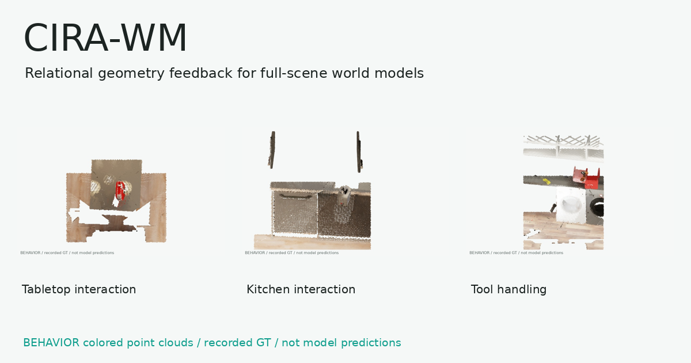

# CIRA-WM

**Relational geometry feedback for full-scene PointWorld prediction.**

[Project Page](https://duyeqwq.github.io/cira-wm/) · [中文](README_ZH.md) · [Method](docs/METHOD.md) · [Status](mark.md)



## The Idea

CIRA adds source-aware robot-to-scene relations and recurrent geometry feedback
to the full PointWorld dynamics predictor. A persistent-constraint variant carries
interaction references through the prediction horizon.

- Separate dual-arm sources and palm/finger roles in local relation queries.
- Feed predicted scene positions back into later relation updates.
- Preserve the original displacement/variance heads through a zero-initialized branch.
- Study persistence with explicit static-background and full-scene error checks.

Known future robot trajectories remain inputs. This is not a causal-identification
claim, a local rigid-body-only predictor or a hardware-ready robot controller.

## Compact Core

| File | Role |
| --- | --- |
| `pointworld/scripts/cira_pointworld/adapter.py` | Main recurrent relational-feedback branch |
| `pointworld/scripts/pointworld_interaction/adapter.py` | Shared source/role-aware relation utilities |
| `outputs/cira_constraint_research_20261021/constraint_transport.py` | Reference transport and constraint fusion |
| `outputs/cira_constraint_research_20261021/test_transport.py` | Standalone CPU geometry checks |

This public companion contains selected method modules, **not** the full
backbone, training runtime, checkpoints or dataset. The detailed research
repository is `D-Star-Robotics/CIRA-WM` and remains private; access is required.
Source identity and video provenance are recorded in `SOURCE_MANIFEST.json`.

With CPU PyTorch installed, the standalone constraint checks run without model
weights, simulator execution or a GPU:

```bash
CUDA_VISIBLE_DEVICES="" OMP_NUM_THREADS=2 python -m unittest discover \
  -s outputs/cira_constraint_research_20261021 -p test_transport.py
```

The CIRA adapter is an integration module for PointWorld, not a standalone
pretrained predictor. Full reproduction requires the original authorized data,
selected weights, audited manifests and the complete research environment.

## Evidence, With Limits

Eight tasks, 23,068 windows per run, two training seeds; episode/task-macro EPE
in mm, averaged across seeds:

| Model | Dynamic ↓ | Static ↓ | All Scene ↓ |
| --- | ---: | ---: | ---: |
| CIRA | 10.145 | **0.726** | **0.911** |
| CIRA + persistence | **10.028** | 0.918 | 1.096 |

Persistence is slightly better on moving points and worse on static/whole-scene
error. It is not a universal improvement. The complete candidate summary also
retains the negative effect-transport results.

A separate long-bar pilot records PointWorld 4/6, CIRA 4/6 and persistent CIRA
6/6 attempts across **only three independent physical initial states**.
Checkpoint-selection rules differ. No significance, broad generalization,
drawer success or hardware-safety claim follows.

[Open-loop evidence](docs/evidence/candidate-open-loop.json) · [Small-pilot evidence](docs/evidence/longbar-small-pilot.json)

## Three Point-Cloud Excerpts

[Tabletop Interaction](docs/media/behavior-radio.mp4) ·
[Kitchen Interaction](docs/media/behavior-kitchen.mp4) ·
[Tool Handling](docs/media/behavior-toolbox.mp4)

Three independent BEHAVIOR colored-point-cloud excerpts, displayed side by side
on the project page. They replay **recorded ground-truth geometry, not CIRA
predictions or learned-policy success**. Each clip contains 11 recorded states,
shown at 2.5 states per playback second; physical timing is not certified.
No new inference, training or simulation was run to produce these visualizations.
[Media source and interpretation](docs/media/README.md).

## Attribution

Built on [NVIDIA PointWorld](https://github.com/NVlabs/PointWorld).
Upstream PointWorld, PTv3 and DINOv3 are not claimed as original CIRA-WM work.
This compact companion does not redistribute pretrained weights or raw datasets.
The rendered excerpts retain their applicable source-data terms.
See [LICENSE](LICENSE) and [NOTICE](NOTICE). No CIRA-WM paper, venue or DOI is asserted.
